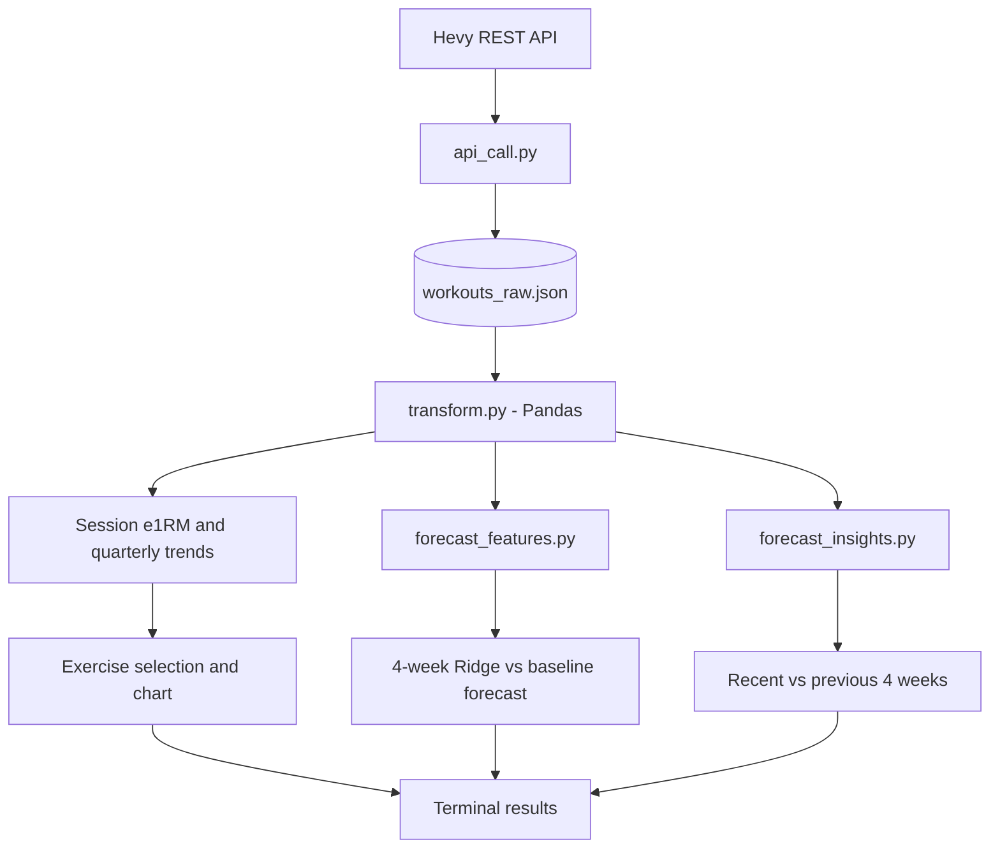

# Hevy Insights 🏋️

**Turn workout logs into strength trends, four-week forecasts, and actionable training context.**

Hevy Insights is a Python command-line project that pulls your workout history from the [Hevy API](https://api.hevyapp.com/docs/), calculates estimated one-rep max (e1RM), tracks quarterly progression, and tests personalized four-week strength predictions against a simple baseline.

## What it does

- **Strength tracking:** Session-best e1RM, quarterly median and peak e1RM, and progression charts.
- **Four-week forecasting:** Ridge regression versus a no-change baseline, using recent strength, volume, frequency, and workout recency.
- **Training insights:** Compare the latest four weeks with the prior four weeks for sessions, working sets, volume, working weight, and median e1RM.
- **Interactive CLI:** Select an exercise and view its analysis in your terminal.

## Data pipeline



## Example: Bench Press

| Metric | Result |
|---|---:|
| Current smoothed e1RM | 192.50 lb |
| Experimental 4-week forecast | **197.22 lb** |
| Predicted change | +4.72 lb |
| Ridge holdout MAE | 11.92 lb |
| No-change baseline MAE | 14.98 lb |
| Recent weekly training volume change | +49.7% |

*Example from one exercise's historical data (October 2026). The seven holdout outcomes are not fully independent; results are exploratory, not a guaranteed prediction. Other exercises favored the baseline.*

## Run locally

**Requirements:** Python 3.9+, a Hevy API key, and the files in this repository.

**1. Clone or download the repository**, then open a terminal inside its folder.

**2. Install dependencies** (macOS/Linux):

```bash
python3 -m venv .venv
source .venv/bin/activate
python -m pip install -r requirements.txt
```

On Windows, activate the environment with `.venv\Scripts\activate` (Command Prompt) or `.venv\Scripts\Activate.ps1` (PowerShell).

**3. Configure your API key.** Create a local `.env` file:

```dotenv
HEVY_API_KEY=your_hevy_api_key
```

**4. Download and analyze your workouts:**

```bash
python api_call.py      # Fetch your Hevy workouts into workouts_raw.json
python transform.py     # Choose an exercise and see its insights
```

Run both commands again to refresh your workout data and analysis. Running only `transform.py` analyzes the most recently downloaded JSON.

## How strength is estimated

Eligible normal working sets with positive load and 1–10 reps use the **Epley formula**:

`e1RM (lb) = weight_lb × (1 + reps / 30)`

- **Quarterly median:** Middle session-best e1RM in a calendar quarter.
- **Quarterly peak:** Highest session-best e1RM in that quarter.
- **Forecast starting point:** Three-session rolling median of session-best e1RM.

## Project files

```text
api_call.py            # Hevy API ingestion and pagination
transform.py           # Pandas transformations, analysis and charts
cli.py                 # Interactive exercise selection
forecast_features.py   # Four-week Ridge/baseline forecasting
forecast_insights.py   # Recent vs prior training comparisons
requirements.txt       # Dependencies
README.md
```

**Tech:** Python · Pandas · NumPy · scikit-learn · Matplotlib · REST API · JSON

## Notes and privacy

- This is an **independent project**, not affiliated with Hevy. e1RM is an estimate, not a tested max; forecasts are experimental and depend on limited, overlapping historical data.
- Weighted pull-ups/dips may record added weight only; bodyweight is not included in their e1RM calculation.
- Keep `.env`, `workouts_raw.json`, and `.venv/` out of Git. If credentials were previously committed, rotate them and address Git history before publishing.
- **Future idea:** Integrate Apple Health data to study how training relates to recovery and activity. *Not implemented in v1.*
